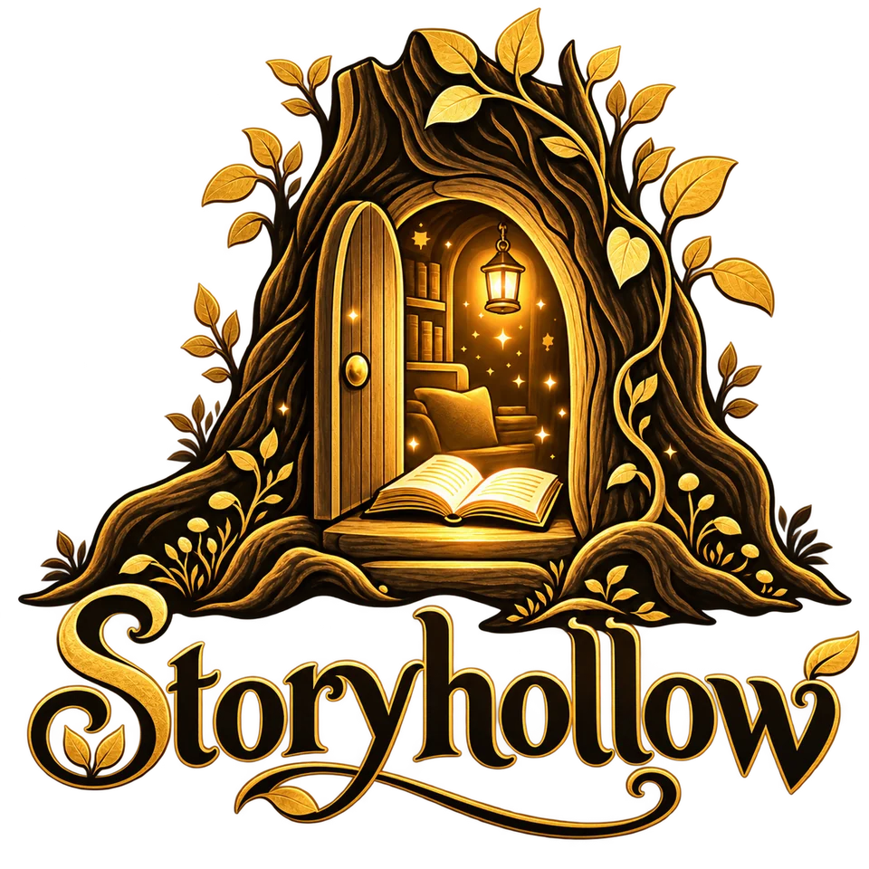

<p align="center"></p>

# Storyhollow

*A hollow old tree where stories live, with a little glowing door.*

**A new story for every night.** Photograph the pages of a book your children love, or something wonderful
you found on a walk, and a cast of storytellers turns it into an immersive audio story, with a soft chime
whenever it's time to turn the page.

Built first for a shadow book whose old read-along had been heard a hundred times. Now every night can bring
a brand-new tale for the very same pictures.

---

## What it does

### ✨ Create a New Story
- **From a book you own.** Snap each page (shadow books, picture books, board books). The storyteller studies
  the pictures and writes a *completely new* story that matches each page, so the child sees exactly what they
  hear. Old printed text in the photos is ignored, never reused.
- **From something you saw.** A puddle, a snail, a sofa-cushion castle: photos from your day become a story.
- **From just an idea.** "A dragon who's afraid of the dark."
- **Shape it:** length (3, 6 or 10 minutes), mood (cozy bedtime, silly, brave adventure, gentle mystery,
  heartwarming, spooky-ish), listener age, your child as the hero, a gentle lesson, special wishes, and a
  🎲 *Surprise us* twist.
- **Never the same twice.** Each book remembers its earlier stories, and the storyteller is told to make
  tonight's clearly different. Characters keep their voices from night to night.
- **Familiar friends, new adventures.** The characters keep the names printed in the book (say, Anton and
  Babette) unless you ask for new ones.
- **Pages in any order.** Photographed the book back to front? The storyteller reads the printed page numbers
  and puts the pages in order for this and every future story. There's also a ⇅ Reverse button.
- **✨ A new story tonight:** one tap on any book writes and records a fresh story with last time's settings.

### 🎭 Voices that feel human
- **A full cast.** The narrator and every character get their own expressive voice from ElevenLabs'
  newest model (Eleven v4), performed as one scene, so turn-taking sounds like real actors and not a robot
  reading lines.
- **Directed delivery.** The script includes cues like `[whispers]`, `[giggles]` and `[sleepily]`, which the
  voices act out.
- **Storybook personas.** Kids pick *Professor Hoot*, *Granny Willow*, *Captain Bramble*… not "voice #12".
- **🪄 Conjure a voice.** Describe one ("a tiny, squeaky mouse who talks very fast"), hear three versions, and
  keep your favorite in the family's voice wardrobe for future stories.

### 💛 Family voices
- **Keepsakes, kept just as they are.** Upload a voicemail, a voice memo or a video (the sound is kept), or
  record right in the app: Grandma's birthday message, your children reading at four. They're tidied into
  MP3s in the browser, filed under each person, and stay private to your family.
- **A grown-up's voice can read anything.** From a minute or so of an adult's recordings, ElevenLabs
  instant voice cloning learns their voice. They then appear first in every storyteller list, ready to read a
  book, a poem or a letter. Making one asks the grown-up to confirm the voice is an adult's and that the family
  has the right to use it (they agreed, or, for someone who has passed away, the family is at peace with it).
- **Never cast by accident.** A family voice only reads when you pick it as the storyteller; the casting
  director never hands Grandma the troll's lines. Children's recordings stay keepsakes and are never cloned.

### 🔔 Made for real books
- **A gentle page-turn chime** (bell, wand sparkle, or wind chime) with an adjustable pause after it.
- **The classic read-along welcome:** *"You'll know it's time to turn the page when you hear this sound…"*
- **✋ Wait for me:** after each chime the story pauses until someone taps, for slow little page-turners.
- **🌙 Lights out:** a near-black screen with ember-dim controls and words, so the phone doesn't wash out a
  shadow book on the bedroom wall. It's off until you turn it on.
- **Aa Read-along words:** each word lights up as it's spoken, right under the picture of the page, which
  helps early readers.
- **🦉 Sound effects on cue** (optional): a sound designer picks a few moments, like a door's creak on
  "creaked" or an owl's hoot, and each short sound lands on its word, softly beneath the voices. Turn
  sounds on or off for any finished story without re-recording the voices.
- **One MP3** with narration, chimes and pauses baked in, so it plays on a lock screen, a Bluetooth speaker or
  in the car, and can be **downloaded for a make-your-own Yoto card**.

### 🎧 Read to Me
- **Pick a book**, then who reads it (whoever read that book last is picked again, so chapter 3 sounds like
  chapters 1 and 2). Add *character voices* so the dialogue is acted out.
- **The Classic Treasury:** Peter Rabbit, Winnie-the-Pooh, The Velveteen Rabbit, The Wind in the Willows,
  Aesop, Grimm and more, plus a search of 70,000+ public-domain books (Project Gutenberg).
- **A book we own:** photograph the pages and the storyteller transcribes the real words exactly, then reads
  them aloud with a chime per page.
- **Our own words:** write, paste, or add a photo or screenshot of a poem, a letter from Granny, a birthday card,
  or a story your child dictated. The storyteller copies the words out of the picture for you to check first.

### 📚 The Library
- A candlelit bookcase. Books stand face-out on shelves (Shadow Books, Picture Books, Tales from the Wild,
  Dreamed-Up Tales, The Classic Treasury, or any shelf you name), and each book holds all its stories.
- Look at the **books** on the bookcase or every **story** in a list. Books stand face-out on the shelves,
  three to a shelf on a phone, each kind under its own brass plaque (small kinds share a shelf on a computer),
  or all together newest first or A to Z. Filter by child, ⭐ favorites or read-alouds, and search everything.
- To rename a book, move it to another shelf or take it off the shelves, open it and tap *Rename, move or remove*.
- **Family accounts with reader cards:** one grown-up login per family, then a "Who's listening tonight?"
  card for each child (no passwords), so everyone finds their own favorites.
- **Grown-up PIN** (optional): children can play anything on the shelves, but creating new stories, which
  spends credits, needs a grown-up.
- **⬇ Download everything:** one ZIP with every story as an MP3 (filed by book), the family recordings (by
  person), the book photos, and a *Read me* page to browse, play and read every story's words. It's the
  family's copy to keep, whatever happens to the app or the subscriptions.

---

## Quick start

You need **Node.js 22.13+**.

```bash
npm install
cp .env.example .env.local     # add your two API keys
npm run dev                    # open http://localhost:3000
```

| Key | What it powers | Where to get it |
| --- | --- | --- |
| `ANTHROPIC_API_KEY` | The storyteller (Claude reads the photos and writes the scripts) | [console.anthropic.com](https://console.anthropic.com) |
| `ELEVENLABS_API_KEY` | The voices, voice design and sound effects | [elevenlabs.io → API keys](https://elevenlabs.io/app/settings/api-keys) |

**No keys yet?** Run `DEMO_MODE=1 npm run dev` to click through every screen with a pretend storyteller and
humming placeholder voices.

### Your first shadow book story
1. Sign up and add a reader card for each child.
2. **Create → A book we own → A new book.** Name it and choose *Shadow book*.
3. Photograph each picture **in order**: the slide or disc itself, or its projection on the wall. One
   photo per page. The ← → buttons reorder pages.
4. Choose the length, mood and voices. Leave *Let me read it before the voices record it* on the first time.
5. Read the script, swap any voice, then press **Record the story**. After a minute or two, press **Listen**.
6. Tomorrow, open the book and tap **✨ A new story tonight**.

---

## How it works

```
 page photos ──► Claude (vision + structured output) ──► script: cast, voices, lines per page
                                                             │
                     grown-up review & edits (optional) ◄────┘
                                                             │
 ElevenLabs Text-to-Dialogue (Eleven v4, PCM + timestamps) ◄─┘   one request per page
                                                             │
 mixer: welcome · page 1 · chime · pause · page 2 · … ◄──────┘   + optional sound effects, each on its word
                                                             │
 story.mp3 + page timeline + word timings ──► player (page cues, wait-for-me, read-along, lock screen)
```

- **Storyteller:** `claude-opus-5-5` with adaptive thinking, a JSON-schema output whose `voice_id` field is
  restricted to the family's real voices, and automatic refusal fallbacks. Prompts:
  `src/lib/server/storyteller.ts`.
- **Voices:** ElevenLabs Text-to-Dialogue performs each page as one multi-voice scene, returning raw PCM
  plus per-character timings (the source of the read-along). If dialogue isn't available on a plan, it
  falls back to line-by-line speech. See `src/lib/server/performer.ts`.
- **Chimes** are synthesized in code (`src/lib/shared/chime.ts`), so the preview in the browser is exactly
  what gets mixed into the story.
- **Mixing and MP3 encoding** are pure JavaScript (`src/lib/server/audio.ts`); no ffmpeg needed.
- **Editing a page only re-records that page.** Recordings are cached by content, and changing the chime
  or the sounds re-binds the story without re-recording any voices.
- **Sound effects** are placed by a small, separate Claude request that reads the finished script
  (`spotSoundEffects` in `src/lib/server/storyteller.ts`), made with ElevenLabs Sound Effects, and laid on
  the spoken word's timing about 8 dB under the narration (`src/lib/server/audio.ts`).
- **Background jobs** keep writing and recording if a phone locks or the page is closed. If the server
  restarts mid-job, the story shows *Try again* and resumes where it stopped.

### Project layout

```
src/app/(library)/   hall, library, book, create wizard, studio, read-to-me, grown-ups
src/app/play/        the player
src/app/api/         auth, profiles, PIN, books, stories, voices, classics, files
src/lib/server/      db (SQLite), auth, storyteller, performer, audio, jobs, classics, voices, offsite (backups), alerts, credits
src/lib/shared/      types, options & presets, personas, chime synthesis
scripts/             start (for Railway), restore-backup
tests/               unit tests and API integration tests (fake Claude, ElevenLabs, S3 and Resend servers)
```

Storage is a single SQLite file plus photos and audio under `DATA_DIR` (default `./data`), using Node's
built-in `node:sqlite`, so there's no database server to run.

### Checks

```bash
npm run typecheck
npm test          # audio, text, and integration tests against fake Claude & ElevenLabs APIs
npm run build
```

---

## Your questions, answered

**Is this better as an app?**
Start as an installable web app (what this is). On iPhone or iPad tap *Share → Add to Home Screen*; on
Android, *Install app*. It opens full-screen with its own icon, the camera works for photographing pages,
audio keeps playing on the lock screen, and every update arrives instantly with no app store review. If you
later want App Store distribution, wrap the same code with Capacitor; nothing needs rewriting.

**Accounts?**
Built in as a *family account* (one grown-up email and password) with *reader cards* for each child, like a
streaming service's profile picker. Books and stories belong to the family, each story remembers who it
was made for, and the library filters by child.

**Can it find books in a library database?**
Partly. Out-of-copyright classics come straight from Project Gutenberg's free catalogue (the Classic
Treasury). Modern picture books are still under copyright and aren't available as text from any open
database or library API, so for those you photograph your own copy and the app reads its real words aloud.
That's for your family's own listening; please don't share those recordings publicly.

---

## Costs

| | Roughly |
| --- | --- |
| Writing a 12-page story (Claude Opus 5.5) | about $0.15–$0.50, depending on photo count and length |
| Recording a 6-minute story | about 5,000 characters of ElevenLabs voice credit. Compare with your plan's monthly allowance. |
| Sound effects for a story | at most 8 short sounds of ElevenLabs credit, made once and kept, plus a tiny Claude request |
| Changing chimes or sounds, replaying, downloading | free (new sound effects aside) |
| Keeping family recordings | free |
| Making a family storytelling voice | included in ElevenLabs plans from Starter up (each voice uses one of your plan's voice slots) |

To trim costs, set `STORY_MODEL=claude-sonnet-5-5` for the storyteller, or pick a shorter length.

The create screen estimates character use before you start. A grown-up PIN keeps small hands from
spending credits.

---

## Hosting it for the family

### On Railway (recommended, about $5 a month)

1. **Get your keys:** an Anthropic API key (console.anthropic.com → Billing → buy credits, $5 minimum →
   API Keys → Create Key) and an ElevenLabs API key (elevenlabs.io → pick a plan → API Keys).
2. Sign in at [railway.com](https://railway.com) with GitHub and choose the **Hobby** plan ($5/month, which
   includes $5 of usage; Storyhollow normally fits inside it).
3. **New Project → Deploy from GitHub repo →** allow access to this repository and pick it.
4. If the repository's main branch isn't the one with Storyhollow, open the service's **Settings → Source**
   and choose the right branch.
5. **Add a volume** to the service with mount path **`/data`**. That's where books, photos and recordings live.
6. **Variables:** add `ANTHROPIC_API_KEY`, `ELEVENLABS_API_KEY` and `SIGNUP_CODE` (a secret word only your
   family knows; it's needed to create a library card).
7. **Settings → Networking → Generate Domain.** That's your Storyhollow address (`…up.railway.app`).
8. Open it, create your library card with the sign-up code, and on the iPad use **Share → Add to Home Screen**.

Railway rebuilds automatically whenever the branch is updated. Leave "serverless / app sleeping" off: stories
are written and recorded in the background.

### Anywhere else

The camera and "Add to Home Screen" need **HTTPS** (or `localhost`).

- **Docker** (a home server, NAS, Fly.io, Render…). Mount a volume for `/data`:
  ```bash
  docker build -t storyhollow .
  docker run -p 3000:3000 -v storyhollow-data:/data \
    -e ANTHROPIC_API_KEY=… -e ELEVENLABS_API_KEY=… -e SIGNUP_CODE=… storyhollow
  ```
- On a home network over plain `http://`, add `-e INSECURE_COOKIES=1` so sign-in cookies work without HTTPS.
- It needs a persistent disk (SQLite + audio files) and a long-running Node process for background jobs, so
  serverless-only hosts aren't a fit as-is.

**Who can sign up:** with `SIGNUP_CODE` set, creating a library needs the code. Without it, only the first
family can sign up and the door closes behind them, so strangers who find the address can't spend your credits.

Optional settings live in `.env.example` (`STORY_MODEL`, `VOICE_MODEL`, `ELEVENLABS_BASE_URL`, `DATA_DIR`).

### Automatic backups

Every night, the app can copy everything (the database, every story's audio, family recordings and book photos)
to S3-compatible cloud storage you own, away from the server: Backblaze B2 (10 GB free), Cloudflare R2 or Amazon
S3. Make a **private** bucket and a key that can read and write only that bucket, then set:

| Variable | What it is |
| --- | --- |
| `BACKUP_ENDPOINT` | The storage's S3 address, e.g. `s3.us-west-004.backblazeb2.com` |
| `BACKUP_BUCKET` | The bucket's name |
| `BACKUP_KEY_ID` | The key's ID (Backblaze: keyID) |
| `BACKUP_SECRET_KEY` | The key's secret (Backblaze: applicationKey) |
| `BACKUP_REGION` | Optional; read from Backblaze and Amazon addresses, `auto` otherwise |

Backups start a few minutes after the app does, then run whenever the last good one is a day old (a failed one is
tried again within the hour). After the first, only new or changed files are sent. The Grown-ups' corner shows how
the last one went and has a **Back up now** button. Each copy of the app keeps its own folder in the bucket
(`production/`, `staging/`), holding `files/` (the data folder) and `database/` (the latest copy plus one a day for
two weeks; the Gutenberg catalogue is left out, since it's fetched again by itself).

**Bringing a backup back:** with the app stopped and the same four variables set,

```bash
node scripts/restore-backup.mjs /data                      # this copy's latest backup
node scripts/restore-backup.mjs --date 2026-10-21 /data    # the database as it was that day
node scripts/restore-backup.mjs --from production /data    # e.g. fill the test copy with the live library
```

It won't write over an existing library unless you add `--force`.

### Problem alerts

The app can email you when something goes wrong that you'd otherwise find at bedtime: a story that didn't
finish writing or recording (with ElevenLabs' or Claude's reason, and a link back to it), a nightly backup that
failed, or voice credit under a tenth of the month's. It sends through [Resend](https://resend.com): make a free
account with the address the alerts should go to, create a key with sending access, and set:

| Variable | What it is |
| --- | --- |
| `RESEND_API_KEY` | The Resend key |
| `ALERT_EMAIL` | Where alerts go (the address the Resend account was made with) |
| `ALERT_FROM` | Optional; defaults to Resend's `onboarding@resend.dev`, which can only send to that address |
| `PUBLIC_URL` | Optional; the app's address for links in emails (on Railway it's found by itself) |

The same problem is sent once (a failed story at most once an hour, a failing backup once a day, low credit once
a month), and never more than 20 emails an hour. The test copy's emails start with "🧪 Test copy". The Grown-ups'
corner shows whether alerts are on, the last few sent, and a **Send a test email** button.

**If the app itself is down** it can't send anything, so point a free uptime monitor (UptimeRobot, Better Stack)
at `https://<your app>/api/health`, every 5 minutes. It answers `{"ok":true}` when the app is up and its library
can be read, and `503` when not.

---

## Roadmap: ideas for even more magic

- **Record a reading:** a child or grandparent reads a real book page by page, with chimes added, as a keepsake
  story on the shelf.
- **Ongoing sagas:** recurring characters with memories across nights ("Ollie remembers last week's
  adventure").
- **Kid-made covers:** photograph a child's drawing as the book's cover.
- **Sleep timer and soundscape-only mode** after the story ends.
- **Offline shelf:** save favorite stories on the device for car trips and flights.
- **Share with family:** send a story link to grandparents, or let them make one for the kids.
- **Stories in other languages**, for bilingual families.
- **Native wrappers** (Capacitor) for App Store / Play Store distribution.
